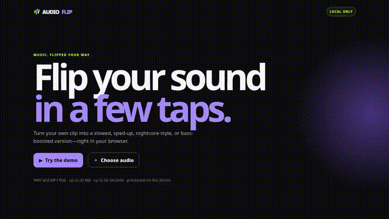
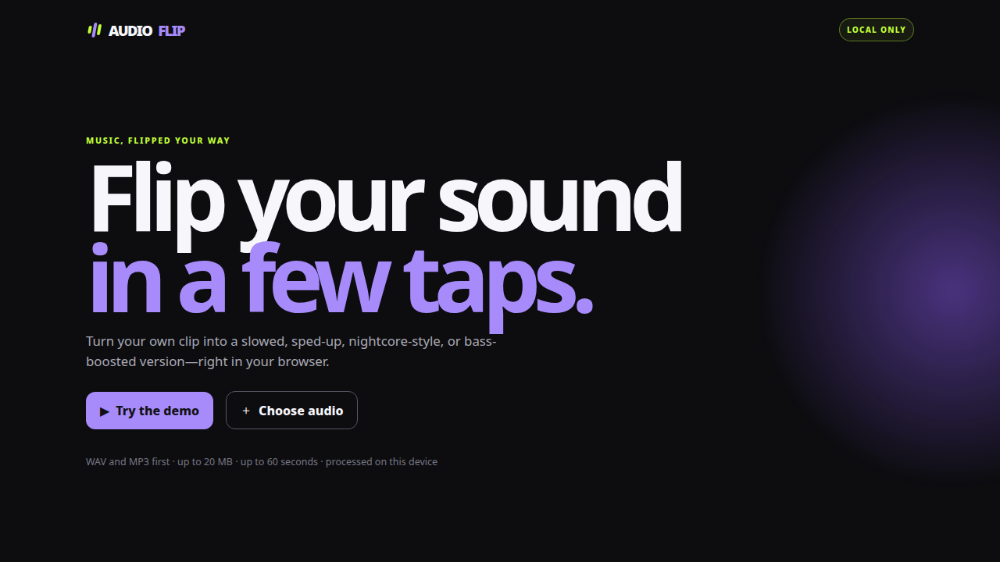

# AudioFlip



[Watch the short demo with a synthesized tone (MP4)](docs/media/audioflip-demo.mp4)



> The README demo uses this app screenshot and a self-synthesized sine tone only; it contains no third-party audio or stock media.

AudioFlip is a **mobile-first, browser-local portfolio project** for turning one audio clip into slowed + reverb, sped-up, nightcore-style, bass-boosted, or original comparison versions—then exporting a WAV or a vertical visualizer video. It is a static React/Vite/TypeScript app: source audio stays in browser memory and is never uploaded.

> Working name only; not trademark-cleared. The GitHub repository is public and the static app is deployed at [audioflip.vercel.app](https://audioflip.vercel.app/). No custom domain, backend, accounts, payment flow, or analytics is included.

## Run locally

Requirements: Node 22+ and pnpm 11+.

```bash
pnpm install --frozen-lockfile
pnpm dev
```

For deterministic checks and a static production output:

```bash
pnpm typecheck
pnpm test
pnpm build
```

`pnpm build` creates `dist/`. `vercel.json` declares the same frozen-lockfile install, build command, and `dist` output for the linked static Vercel project. The production alias is [audioflip.vercel.app](https://audioflip.vercel.app/); no custom domain, analytics, backend, account, or payment setup is included.

## Use it

1. Choose **Try the demo** for a locally generated slowed + reverb result, or select/drop an audio file. With a source loaded, the prominent **Slowed + reverb** and **Sped up** buttons reuse the documented defaults, render, and begin the existing processed preview when the browser allows it.
2. Trim the source, choose an effect, and render the exact PCM16 WAV result.
3. Download the WAV or use **Download video** to record a local 9:16 visualizer video. After export, use the **Post it** checklist: download the file, open TikTok yourself, then upload under that platform’s own rights and format rules.

**Loop preview** is off by default and remains only in browser memory. Turn it on to repeat the exact selected trim in **Play original**, or the full peak-guarded output in **Play processed**, until you stop it. Changing the switch stops an active preview before the next playback. It does not alter, upload, persist, or bake a loop into WAV/video exports. Chosen loop points can depend on the source waveform and browser engine, so no click-free or gapless-loop guarantee is made.

The app never posts to TikTok or any other platform. It does not use localStorage for raw audio, identity, or analytics; it retains only the active source, current render, and most recent export URLs, which are revoked when replaced or cleared.

## What the editor does

| Effect | Controls | Honest behavior |
| --- | --- | --- |
| Original | Trim | Re-encodes the selected source range as WAV for comparison; peak protection can make it quieter than the source. |
| Slowed + reverb | 0.65–1.00×; 0–40% wet | Playback-rate slowdown plus a short generated reverb tail. |
| Sped up | 1.00–1.50× | Dry faster playback. |
| Nightcore-style | 1.10–1.60×; optional brightness | Coupled faster playback and higher pitch, not independent pitch shifting. |
| Bass boost | 0–12 dB low shelf at 120 Hz | Low-end lift protected by a shared peak guard. |

Playback-rate changes **pitch and duration together**. AudioFlip does not provide independent pitch shifting, time stretching, LUFS normalization, mastering, or a promise of distortion-free bass on every speaker.

### Vertical video export

After rendering, supported browsers expose **Download video** beside the WAV action. The export creates a dark-charcoal, violet/lime, 9:16 canvas with live analyser-driven bars, the selected effect, an optional 40-character title, and `made with AudioFlip`. It records in real time using native `canvas.captureStream`, `MediaStreamAudioDestinationNode`, and `MediaRecorder`.

- The browser chooses the first reported supported format in this order: H.264/AAC MP4, generic MP4, VP9/Opus WebM, VP8/Opus WebM, then plain WebM.
- The final Blob must be non-empty and report a recognized MP4 or WebM MIME type. Its filename extension is derived from that reported type; AudioFlip never offers an empty, unknown, or mislabeled video file.
- Video is capped at 60 seconds. A slowed render longer than that uses its first 60 seconds. To avoid browser recorders omitting a visual track on extremely short clips, audio below one second receives a one-second visual hold while its audio remains unpadded.
- The final second includes a small in-frame `AudioFlip - audioflip.vercel.app` watermark; it never extends the capped recording duration.
- Recording shows real elapsed progress and can be cancelled. The result remains a local file; Web Share appears only when the browser confirms it can share that file.
- If `MediaRecorder`, canvas capture, a compatible recorder type, or audio playback is unavailable, the action explains the limitation and keeps the WAV path available. Export cleanup stops tracks/nodes and closes the temporary export audio context; the editor recreates audio after the next user gesture.

## Limits and support

- **Input:** 20 MiB and 60 decoded source seconds. The file size is checked before decoding, but compressed audio can still expand in browser memory before decoded-duration validation.
- **Input formats:** WAV and MP3 are the first-class choices. Other audio is accepted only when the active browser successfully decodes it; extensions and MIME labels alone are not trusted.
- **WAV output:** genuine little-endian RIFF/WAVE PCM16. The renderer targets 44.1 kHz and falls back to a safely bounded decoded source rate only if required. Mono remains mono; non-mono source is mixed to stereo through the browser Web Audio graph.
- **Video output:** depends on `AudioContext`, `OfflineAudioContext`, `decodeAudioData`, `AudioBuffer`, canvas capture, `MediaStreamAudioDestinationNode`, and `MediaRecorder`. The recording path is browser-specific; the visible extension reflects its actual reported container.
- **Verified target:** current sandbox Chromium. Firefox, WebKit, current iOS Safari, Android Chrome, physical-device behavior, and subjective audio listening are not claimed as verified unless recorded in a validation report.
- **Rights:** Only use audio you own or have permission to edit and publish. Effects and visualizers do not remove copyright restrictions.

## Tests and current evidence

`tests/audio.test.ts` covers trim/rate math, effect validation, allocation limits, peak safety, decoder size protection, and RIFF/PCM16 WAV output. `tests/playback-loop.test.ts` covers one-pass playback plus exact trimmed-source and full-render loop boundaries. `tests/peak-service.test.ts` covers worker selection/transfer limits, detached copied channel buffers, valid worker parity, and malformed/post-error/unavailable-worker fallback. `tests/creator-modal.test.tsx` covers keyboard modal containment. `tests/app-lifecycle.test.tsx` covers source/result invalidation and routes the visible loop switch through original playback. `tests/video-export.test.ts` covers runtime MIME selection, title cleanup/truncation, share-caption text, short-video compatibility bounds, and 9:16 canvas sizing without attempting a real MediaRecorder session in Vitest.

### Optional large-buffer peak worker

For a rendered buffer of at least **1,000,000** samples and no more than **32 MiB** of temporary copied channel PCM, AudioFlip starts a Vite module worker to calculate the finite global peak and its shared guard gain. It copies each `Float32Array` before transfer, so the live `AudioBuffer` remains usable for preview, safe-buffer creation, and PCM encoding. Small buffers, a missing/failed/slow worker, malformed result, allocation/copy failure, or an over-budget transfer use the same mandatory main-thread `peakOf` + `peakGuardGain` safety path. This is a responsiveness measure, not a measured speedup claim, and it does not upload or persist audio.

Clear, replacement, trim/effect/settings change, reset, a new render, and unmount abort an in-flight peak worker: its timer/listener and pending rendered-buffer reference are released and the worker is terminated without a stale main-thread fallback scan. Browser-native `OfflineAudioContext` rendering is not force-cancelled, but an invalidated render cannot continue into worker copying, guarded-buffer allocation, WAV/Blob creation, or stale editor state after it settles. The guarded buffer tries the global `AudioBuffer` constructor first and the existing offline context’s `createBuffer` second; if neither can allocate a correctly shaped output, no preview or download is created.

### Phase 3 validation snapshot (2026-10-13)

- `pnpm install --frozen-lockfile`, `pnpm typecheck`, `pnpm test`, and `pnpm build` passed. Vitest reported **15/15 tests** across four files, and the static route manifest returned `{"routes":[{"path":"/","title":"AudioFlip"}]}`.
- In the sandbox Chromium preview, the one-tap demo created the slowed + reverb result and exposed the video action. The Original, Slowed + reverb, Sped up, Nightcore-style, and Bass boost presets each rendered a result with the expected WAV filename.
- A downloaded 0.25-second Original WAV independently decoded as stereo, 44,100 Hz, PCM16, 11,025 frames, with integer peak 32,112.
- Native recording reported `video/mp4` in this browser. The repaired short-output file was a genuine 720×1280 MP4 container, 1.031 seconds and 50,846 bytes; `ffprobe` found VP9 video plus Opus stereo audio at 48 kHz. An extracted frame showed the intended title, effect label, violet/lime visualizer, progress bar, and `made with AudioFlip` footer. This is technical container/frame validation, not a subjective listening or platform-acceptance claim.
- The sandbox did not report file-sharing support, so the Web Share button was correctly hidden. The browser-click caption path showed **Copied caption**. Full-page 1280 px desktop and 375 px mobile layouts were captured and reviewed.
- **Unverified:** physical-device audible playback, current iOS Safari/Android Chrome, Firefox/WebKit codec behavior, subjective sound quality, TikTok upload acceptance, and public-deployment social-crawler behavior.

### Phase 4 worker validation snapshot (2026-10-13)

- `pnpm typecheck`, `pnpm test`, and `pnpm build` passed with **19/19 tests**. The production bundle includes a separate `peak-worker-*.js` asset.
- In sandbox Chromium, the 10-second stereo demo’s slowed + reverb render (about 13.7 seconds after rate/tail processing) crossed the worker threshold and loaded the `peak-worker.ts?worker_file&type=module` module. The render completed with a peak-guarded WAV result.
- This confirms worker construction and the browser render path in one Chromium environment. It is **not** a benchmark, a mobile performance claim, or evidence that Worker APIs/codec behavior work on every browser.
- Vercel production served `https://audioflip.vercel.app/` with an unauthenticated HTTP **200**, HTTPS/HSTS, the expected static HTML title, and Vite asset references. The static production URL loaded normally in the sandbox browser. This confirms the hosted page response, not universal network allowlisting or social-crawler parsing.

### Phase 5 cancellation and allocation validation snapshot (2026-10-13)

- `pnpm typecheck`, `pnpm test`, and `pnpm build` passed with **23/23 tests** across six files, including abort-before-dispatch, pending worker cancellation/recreation, and both safe-buffer allocator paths.
- In sandbox Chromium, a deliberately delayed eligible peak-worker dispatch was cleared after the worker asset loaded. The app terminated the worker once, returned to **No source loaded**, and still had no processed result or processing state after the delayed post interval elapsed.
- **Unverified:** forced cancellation of browser-native `OfflineAudioContext` itself (the API does not provide this guarantee), mobile/WebKit worker behavior, and measured performance/memory improvement. The implementation makes no claim about those surfaces.

### Phase 6 release-hardening validation snapshot (2026-10-13)

- `pnpm typecheck`, `pnpm test`, and `pnpm build` passed with **27/27 tests** across seven files. New pure-function coverage checks H.264/MP4/WebM fallback ordering, empty/unknown Blob rejection, quick-preset settings parity, and final-second end-card bounds.
- In sandbox Chromium, the one-tap **Sped up** action rendered the 1.25× result and started processed preview. An 8-second, 720×1280 MP4 export reported VP9 video plus Opus audio, and a 7.3-second extracted frame visibly contained the in-frame `AudioFlip - audioflip.vercel.app` watermark.
- **Not verified on real devices:** iOS Safari export/save, Android Chrome export/save, real-time recording under heavy CPU load, and playback/upload acceptance in TikTok or Instagram. Container/frame inspection and sandbox Chromium do not establish those device/platform behaviors.

### Phase 7 local preview-loop validation snapshot (2026-10-15)

- `pnpm install --frozen-lockfile`, `pnpm typecheck`, `pnpm test`, and `pnpm build` passed. Vitest reported **31/31 tests** across eight files, including engine-level one-pass, selected-trim loop, full-render loop, and visible-control coverage.
- In sandbox Chromium, the generated 10-second demo rendered successfully. Enabling **Loop preview** updated its pressed state and disclosure, and the original preview remained active after a 10.5-second wait—past its first pass. Turning the switch off stopped that active preview. Clearing the source reset and disabled the loop control and removed the rendered result.
- This confirms the repeat/stop lifecycle in one Chromium environment. Subjective listening, exact click-free boundaries for arbitrary source material, Firefox/WebKit, and physical mobile-device behavior remain unverified.

## Rust/WASM status

**Rust/WASM is not shipped.** It remains deferred for this pass. TypeScript owns trim/rate validation, sample sanitation, PCM encoding, and the peak calculation through a main-thread path plus an optional copied-buffer module-worker fallback; browser Web Audio owns decode, filters, reverb, playback, and offline rendering. The prior fresh toolchain gate and its exact blocker are documented in [docs/RUST_WASM_GATE_RECORD.md](docs/RUST_WASM_GATE_RECORD.md). Do not describe the draft snippets as compiled or executed Rust.

## Roadmap

| Planned item | Status | Boundary |
| --- | --- | --- |
| Rust/WASM DSP module | Planned after profiling | Limited to post-render finite-sample peak/gain/PCM work, with TypeScript fallback and proven browser execution. |
| Creator plan | Proposed, not for sale | Future reusable presets and bounded batch processing require a separately approved server-backed entitlement and billing design. |
| Batch export | Planned | Must preserve local-audio privacy and enforce explicit memory/duration limits before implementation. |

## License

AudioFlip is available under the [MIT License](LICENSE), copyright Eric King (2026).
